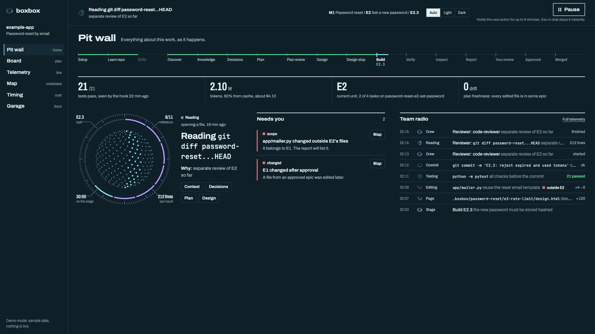

# /boxbox

AI coding that pits for review.

"Box, box" is the radio call that brings a Formula 1 driver into the pits. The AI agent is the driver: fast, and doing the driving. You are the pit wall: you have the data, you make the calls, and the car comes in when you say. You type a feature. The agent reads your codebase, splits the work into milestones, epics and tasks, asks you for the decisions that matter, and builds one small tested unit at a time. After every unit it stops, opens the code for review, and shows you a page that explains what was built and why.

You end up with code you can explain, because you made the decisions and read the reasoning.

Just tell your agent: `/boxbox:boxbox let users reset their password by email`. Or skip the command and describe the feature: Boxbox picks it up on its own.

## Install /boxbox

**Claude Code** (CLI and the VS Code extension):

```
/plugin marketplace add sushant-rai-23/BoxBox
/plugin install boxbox@boxbox
```

The same two lines work in a terminal as `claude plugin marketplace add ...` and `claude plugin install ...`. Run them once per machine, then restart Claude Code. Then run `/boxbox:boxbox` inside any project (plugin commands carry the plugin name), or just describe a feature: the session-start hook starts the flow on its own.

To update it later:

```
claude plugin update boxbox@boxbox
```

**Codex:**

```
codex plugin marketplace add sushant-rai-23/BoxBox
codex plugin add boxbox@boxbox
```

To update it later:

```
codex plugin marketplace upgrade boxbox
codex plugin add boxbox@boxbox
```

**Any other agent** (Cursor, Copilot, Gemini CLI, opencode, and more), one command via the skills CLI:

```
npx skills add https://github.com/sushant-rai-23/BoxBox --skill '*'
```

Add `-g` to install globally (available in every project); drop it to scope to the current one. Install all the skills: the entry skill hands off to the others by name.

<details>
<summary>No installer? Copy the skills directly.</summary>

```
git clone https://github.com/sushant-rai-23/BoxBox
cd BoxBox
./install.sh claude      # ~/.claude/skills
./install.sh cursor      # ~/.cursor/skills
./install.sh codex       # ~/.agents/skills
./install.sh --dir <your agent's skills folder>
```

Add `--project` to install into the current repo instead of your home folder. Run it again to update.

Without the session-start hook, start the flow by naming it: "use boxbox to add password reset". After the first run, setup adds a line to the repo's `AGENTS.md` so later sessions start on their own.

</details>

**Also works with:** the repo ships `.claude/skills`, `.agents/skills`, `.cursor/skills` and `.opencode/skills` as links to `skills/`, so a plain clone is picked up by Claude Code, Codex, Cursor and opencode as project skills. Any other agent can be pointed at `skills/boxbox/SKILL.md`. On Windows, enable symlinks in Git (`git config core.symlinks true`) or use `install.sh`.

## What you get

- **The pit wall**: a live page on your machine showing what the agent is doing right now, where the work stands, what is waiting on you, and what it costs. With a pause button.
- **A board** (`.boxbox/board.html`): the whole project as a tree of milestones, epics and tasks, with status and links to every page.
- **A context page** before any decision: what exists, what the feature touches, which concepts are new to you, how it can fail.
- **A decisions page**: one card per decision, with options, trade-offs and a recommendation. You answer one at a time.
- **A plan page** you approve before any code is written.
- **A design page** for large epics: data shapes and interfaces, approved before the code.
- **A report per unit** that teaches the code that was just written, at your level, with a pull request to review.
- **Knowledge pages** for anything in the stack that is new to you.
- **An explanation page** for any existing feature, milestone or branch, on request: say "explain the login feature" or "explain milestone 0". Works on code built without Boxbox.
- **Review notes** for a branch or pull request someone else built, at the depth you choose: say "help me review PR 42".

Every step also writes a short Markdown file, so a new session or a different model can pick up where the last one stopped.

## The pages

Every page is a finished template in `.boxbox/templates/`. The agent copies it with `cp`, fills its named sections with content, and never writes layout or CSS. That keeps pages consistent, and cheaper to produce: the agent spends its tokens on what the page says, not on how it looks.

- **Built to learn from.** Each template asks for the sections a developer needs to understand the work cold: the request path through the code, annotated real code, diagrams of the real modules, tests marked observed or claimed, trade-offs, risks, a manual checklist, how to roll back, and questions to check yourself. Depth follows what you told setup you know: new ideas get explained, known ones get a line.
- **Checked before you see it.** `node .boxbox/pitwall/check-page.js <page>` fails a page with a leftover placeholder, any CSS, a class outside the component gallery, a missing or too-thin section, a link to a page that does not exist, a diagram without a text alternative, or lines that read as machine-made. Every skill runs it and fixes what it finds before opening the page.
- **True, or marked as unknown.** Every claim on a report, context, review or explain page says where it comes from: observed, from the code, inferred, unknown, or from a linked source. Test results, changed lines, commits, branches, tokens and cost are read from git and the pit wall, and the checker fails the page if they disagree. Quoted code must match the repo byte for byte, and every file:line, test name and commit hash must exist. A separate agent then fact-checks the claims before you see the page, and each report ends with the three claims to verify yourself.
- **One look everywhere.** The pit wall, the board and every page share one stylesheet (`assets/boxbox.css`) and a dark/light switch in the top bar. It follows your system setting until you choose, and remembers your choice when the browser allows it.

Pages written by 0.5 keep working after an update: their old stylesheet stays in the kit.

## Use

In your repo, tell the agent what you want:

```
Let users reset their password by email.
```

The first time, Boxbox sets itself up: it reads the repo and asks you five short questions (what you know, where to stop for review, how many decisions you want to make, whether it may push, whether to open the pit wall). Then:

1. It opens the **context page**.
2. It opens the **decisions page** and asks you each decision.
3. It opens the **plan** and waits. Say `go`.
4. It builds the first unit, has it reviewed by a separate agent, opens the **report** and a draft pull request, and waits. Say `approved`, or say what to change.
5. It repeats step 4 for each unit.

Things you can say at any stop: `go`, `change ...`, `switch to task-level`, `ask me everything`, `decide and show`, `park D3`, `explain ...`, `why ...`, `review ...`, `grill the plan`, `design E2 first`, `prototype ...`, `pause`.

The pit wall opens in your browser while setup runs and shows every step from then on. Without Node, open `.boxbox/board.html` instead.

## The pit wall



A local page, served by a small Node script inside `.boxbox/pitwall/` (Node 18+, no dependencies) on `127.0.0.1`. Each new session starts it and prints its address, `http://127.0.0.1:4747/` unless that port is busy. Six views, each named the racing way with the plain name in brackets:

| View | What it is for |
| --- | --- |
| **Pit wall** (Home) | Where the work is in the Boxbox flow (setup, discover, decisions, plan, build E2.3, verify, review...), what the agent is doing this second, what needs you, tests, spend, plan freshness, and in Claude Code the routing readout: the `models:` mode, whether the routing gate is on (and why not), the Boxbox agents running, the last escalation |
| **Board** (Plan) | Milestones, epics and tasks. A task turns purple, **verified**, only when a passing test run was seen after its last edit; done without one, it says **claimed** |
| **Telemetry** (Live) | Every tool call as it happens, by kind: reading, searching, editing, terminal, testing, web, pages, commits, skills, subagents, routing. Each row carries a chip naming the model that did it. Lanes for the main agent, the builder (one per builder when tasks run in parallel), scout, runner, writer, other subagents and the reviewer |
| **Map** (Codebase) | The repo's modules, which ones are being edited, and the current epic's declared files. An edit outside them shows in red and lands in "Needs you" |
| **Timing** (Cost) | Tokens per epic and per task, new versus cache, and the sessions behind them, read from the agent's own session logs, subagents included (each subagent's tokens go to its own task). Tokens, cost and cache-read share by model; escalations and denied subagent calls; and "saved versus all on the session model", labelled as an estimate. Cost shows as "about $X" from `.boxbox/pitwall/prices.json`, which you can edit; a model missing from it shows tokens only |
| **Garage** (Docs) | Every page Boxbox wrote for this repo, searchable |

**Your move.** Whenever the agent needs you (a decision, a plan or design to approve, a unit to review, a permission prompt, or it has simply finished its turn), a full-width amber bar says what, with "Answer in chat", and the tab title changes to "Your move · Boxbox". It clears when you reply.

**Pause.** Press Pause and the agent's next tool call is held. Resume and it runs, as if nothing happened. Leave it paused for about nine minutes and the agent stops, writes down where it was, and waits for you to say `continue`. Pause holds the next action; it cannot stop text the agent is already writing. Esc in the chat does that.

**Nothing leaves your machine.** The page binds to `127.0.0.1` only, and the pause buttons need a token that only the served page has. Live data sits in `.boxbox/live/`, which setup adds to `.gitignore`: tool names, file paths and one-line results, never file contents, your prompts or command output, and anything that looks like a secret in a command is masked. Repos without a `.boxbox/` folder are not logged at all. Pages that Boxbox wrote open from the pit wall in a sandbox, so a page in the repo cannot press Pause for you; the cost is that checklist ticks on a page opened from the pit wall do not stay ticked, and the theme comes from the link rather than from memory. Open the file directly (`.boxbox/knowledge/<topic>.html`) to keep ticks.

**Per agent.** Claude Code: everything above. Codex: the same, built from Codex's source and documentation but **unverified**, not yet run end to end; run `/hooks` in Codex once to trust Boxbox's hooks, and again after each Boxbox update. Codex web searches run on OpenAI's side and do not show. Cursor: the pages and the board, no live feed yet.

Try it without an agent: `node .boxbox/pitwall/server.js --ensure`, then open the printed address with `?demo` on the end for sample data.

## How much control

| Setting | Options |
| --- | --- |
| Unit of control | `epic` (stop after each feature) or `task` (stop after each small change) |
| Decision level | `everything`, `what matters` (default), `decide and show` |
| Pushing | `yes`, `ask`, `no` |
| Models (Claude Code) | `balanced` (default), `best`, `save`, `auto` (see below) |
| Parallel tasks (Claude Code) | `off` (default) or `on` |

All of them live in `.boxbox/config.md` and can be changed whenever you like. Whatever the level, the agent never does something that cannot be undone without asking.

## Cheaper models, same judgement (Claude Code)

Planning, decisions, design, task briefs, code review, the page fact-check and every approval stay on your session model. Routine work goes to four small subagents that ship with the plugin:

| Agent | `balanced` | `save` | Does | Never |
| --- | --- | --- | --- | --- |
| `boxbox-builder` | Sonnet | Sonnet | builds one task test-first from its brief, commits | touches files outside the brief, edits `.boxbox/` |
| `boxbox-scout` | Haiku | Haiku | reads and searches, returns exact excerpts with file:line | edits anything |
| `boxbox-runner` | Haiku | Haiku | runs tests, lint and the page checker; fixes only mechanical failures | changes behaviour |
| `boxbox-writer` | Sonnet | Haiku | fills page templates from the facts it is given | invents facts |

`best` puts every agent on your session model; `auto` uses no Boxbox agents and sets no models, as before 0.7 (a repo set up before 0.7 has no `models:` line and stays on `auto` until you choose). A task tagged `risk: yes` (auth, payments, crypto, migrations, concurrency) or `size: L` builds on your session model except under `save`, and "use opus for E3" pins one epic.

- **Task briefs.** Before each task, the main model writes `.boxbox/<feature>/<epic>/tasks/<task>.md` from the code as it is now: the goal, the exact excerpts to change, the interface, the tests, what not to touch, the done check, the expected diff size. The builder gets only that, after a fixed part that never changes, so the prompt cache does its work. The board, the pit wall and the report link and quote each brief.
- **Routing gate.** A hook checks every call to a Boxbox agent against these rules and denies a wrong one with a reason that names the right agent and model ("E2.3 is risk: yes, run boxbox-builder with model opus"). It stands aside under `models: auto` and when `CLAUDE_CODE_SUBAGENT_MODEL_FORCE` is set, and says why on the pit wall.
- **Escalation.** A builder that fails a task twice, edits outside its brief, or edits one file five times without a green test, retries once on your session model. If that fails too, the agent stops and tells you.
- **Exact cost per model.** Subagent transcripts are counted from the moment a subagent starts, per model and per task, and checked against Claude Code's own totals.
- **Status line** (optional, asked at setup): `E2.3 · builder sonnet · session $0.42 · 14/14 tests` under your prompt. Terminal only; the VS Code extension may not show it.
- **Parallel tasks** (`parallel: on`, off by default): independent tasks of one epic build at once in separate worktrees, at most three, then merge back in plan order with one commit per task. Needs `"worktree": {"baseRef": "head"}` in the project's settings; any conflict or red suite falls back to one task at a time.

What each agent gets:

| Feature | Claude Code | Codex |
| --- | --- | --- |
| Plan, decisions, units, reports, pit wall, pause | Yes | Yes (as in 0.6) |
| Task briefs | Yes, built by `boxbox-builder` | Yes, built by the main agent |
| Fixed-model subagents (`models:`) | Yes | No: the main agent does everything |
| Routing gate and escalation | Yes | No |
| Tokens and cost by model | Yes, subagents included | Per session, with the Codex model; no Codex prices unless you add them |
| Status line | Yes (terminal) | No |
| Parallel tasks | Yes, off by default | No |

How the Claude Code features were checked is written up in [docs/routing-spike.md](docs/routing-spike.md). **Not yet verified in a live session** (tested with recorded real transcripts and unit tests only): a full build in `balanced` mode following the new skills, a live escalation, a live parallel build and merge, and the status line in a running CLI session. A gate denial and the agent's retry were seen live.

## The skills and how to use them

Nineteen skills. Most run on their own as part of the flow. Each can also be called directly with `/boxbox:<name>` followed by what you want, in your own words.

### Flow

| Skill | What it does | Runs on its own | Call it directly | Produces |
| --- | --- | --- | --- | --- |
| `boxbox` | Entry point: picks the flow for the request | On any feature, bug or planning request, via the session-start hook | `/boxbox:boxbox let users reset their password by email` | The flow: context, decisions, plan, then one unit at a time |
| `boxbox-setup` | One-time setup: reads the stack, asks up to seven questions, starts the pit wall | When `.boxbox/` is missing | `/boxbox:boxbox-setup change the unit to task` | `.boxbox/` with `config.md`, the board, the templates and the pit wall |
| `boxbox-discover` | Reads the code a feature will touch, writes the context page | First step of the full flow | `/boxbox:boxbox-discover what would a password reset touch?` | `context.md` and `context.html`; knowledge pages for what is new to you |
| `boxbox-plan` | Splits the work, asks decisions one at a time, writes the plan | After discover | `/boxbox:boxbox-plan re-plan E2 with magic links` | `decisions.html`, `plan.md` and `plan.html`; stops for `go` |
| `boxbox-design` | Data shapes and interfaces for a large epic, for approval before code | When the plan marks an epic `design: yes` | `/boxbox:boxbox-design design E2 first` | `design.md` and `design.html`; stops for approval |
| `boxbox-build` | Builds one unit test-first, verifies it, has it inspected | After `go`, and after each unit is approved | `/boxbox:boxbox-build continue with E2` | One commit per task on the unit's branch |
| `boxbox-report` | Writes the report, opens the code for review, handles your reply | After every built unit | `/boxbox:boxbox-report write the report for E1` | `report.md`, `report.html`, a draft pull request; stops |
| `boxbox-primer` | Teaches one concept, up to the level this project needs | When discover or explain marks a concept new to you | `/boxbox:boxbox-primer teach me job queues` | `knowledge/<topic>.html` |
| `boxbox-resume` | Picks up or pauses work | On `continue`, `go`, `approved`, or when `state.md` shows work in progress | `/boxbox:boxbox-resume where were we?` | Work resumed at the right stop, or `state.md` written for a pause |
| `boxbox-explain` | Explains code or finished work, in chat or as a page. Works on code built without Boxbox | On `explain ...` or `how does X work` at any stop | `/boxbox:boxbox-explain explain milestone 0` | An answer in chat, or `explained/<name>.html` with pieces, commits, decisions, checks and findings |
| `boxbox-review` | Helps you review a branch or pull request you did not build, at the depth you choose. Never approves or merges | Only when you ask | `/boxbox:boxbox-review help me review PR 42` | `reviews/<name>.md` and `.html`: start here, each piece, evidence, findings, a checklist |

### Craft

| Skill | What it does | Runs on its own | Call it directly | Produces |
| --- | --- | --- | --- | --- |
| `boxbox-tdd` | Test-first loop: failing test, least code, refactor | Every task in a build | `/boxbox:boxbox-tdd add a regression test for the empty-cart bug` | A test that failed first, then the code that passes it |
| `boxbox-debug` | Root cause before any fix | On a bug, or when a test fails for an unknown reason | `/boxbox:boxbox-debug why does login return 500 on an empty email?` | The cause, with evidence, before a fix |
| `boxbox-verify` | Proves work by running it, now | Before any claim of done, before every report | `/boxbox:boxbox-verify prove E1 works end to end` | Evidence per acceptance criterion, or "not verified" with the reason |
| `boxbox-inspect` | A separate reviewer agent checks the agent's own diff; acts on your review comments | After every unit is verified, and on requested changes | `/boxbox:boxbox-inspect check this diff` | Findings by severity, fixes as new commits, a review note for the report |
| `boxbox-why` | Finds why code is the way it is, from git and issue history | On `why ...` at any stop; before a plan changes something whose reason is unclear | `/boxbox:boxbox-why why is the session store in Redis?` | An answer with its evidence and how sure it is |
| `boxbox-grill` | Challenges a plan or a decision with hard questions | Offered at the plan stop when a decision is costly to reverse | `/boxbox:boxbox-grill grill the plan` | Holes found, decisions changed, recorded in `decisions.md` |
| `boxbox-prototype` | Throwaway code to settle a design question | When a decision depends on something only running code can show | `/boxbox:boxbox-prototype try both and compare` | A comparison and a recommendation; the code is thrown away |
| `boxbox-lessons` | Turns your corrections into rules and checks | When you correct how the agent works; at the end of a feature | `/boxbox:boxbox-lessons what have we learned?` | A row in `lessons.md`, and a check when a mistake repeats |

## Status

Version 0.7.0. Built and tried with Claude Code, including the pit wall's hooks, pause and token counts. Model routing, task briefs, the routing gate and per-model cost are Claude Code features (Codex gets task briefs); what was and was not verified live is listed under "Cheaper models, same judgement". The Codex pit wall (hooks, pause, token counts) is built from Codex's source and is unverified until it has been run end to end. The Cursor and skills-CLI paths follow what other skill packs ship and have not been run end to end on those agents yet.

## License

MIT. See `NOTICE.md` for the projects whose ideas this builds on.
