# Using Boxbox well

A practical guide for developers who want an AI agent to do the typing while they stay in charge of the code. It takes about fifteen minutes to read, and the first feature is the best way to learn the rest.

Boxbox is for work you will have to own: features in a real codebase, bugs you need to understand, code you will review, maintain or defend. It is slower than letting an agent run free for a one-line fix or a throwaway script, so use the short flow or skip Boxbox for those.

## How it works, in one picture

You describe a feature. The agent:

1. reads the code;
2. asks you the decisions that matter;
3. writes a plan you approve;
4. builds the work one small, tested unit at a time.

After every unit it stops, has a separate agent review the code, and shows you a page that teaches what was built. Nothing moves on until you say so.

```
you: "let users reset their password by email"
  -> context page      what exists, what this touches, what is new to you, how it can fail
  -> decisions page    one card per decision; you answer one at a time
  -> plan page         epics and tasks; you say "go"
  -> for each epic:    design (if big) -> build test-first -> separate review -> report page; you say "approved"
```


## Install and first run (5 minutes)

Claude Code:

```
/plugin marketplace add sushant-rai-23/BoxBox
/plugin install boxbox@boxbox
```

Restart Claude Code, open your repo, and describe a feature. For Codex and other agents, see the README's install section.

The first time, Boxbox sets itself up. It reads your repo (stack, test command, branches) and asks up to seven short questions. Your answers live in `.boxbox/config.md`, and you can change them any time:

| Question | What to answer, and when |
| --- | --- |
| What you know | Be honest. Anything you mark new gets explained on every page and may get a knowledge page. Anything you know gets one line. |
| Where to stop | `epic` (one review per working slice) for most work. `task` when the stack is new to you or the change is delicate. |
| How many decisions | `what matters` (the default): you decide what is costly to change, and small defaults are listed for you to override. `everything` when you are learning; `decide and show` when you trust the agent on this repo. |
| Pushing | `ask` if you are not sure. `yes` lets it push branches and open draft pull requests. |
| Pit wall | `yes`. It is the fastest way to see what is happening. |
| Models (Claude Code) | `balanced`. See "Spend less" below. |
| Status line (Claude Code) | `yes` if you work in the terminal. |

## The stops, and what to do at each

Boxbox stops exactly when it needs you. The pit wall shows an amber "Your move" bar, and the status line says `Your move: ...`. Here is how to use each stop well.

### 1. Context: read before you decide

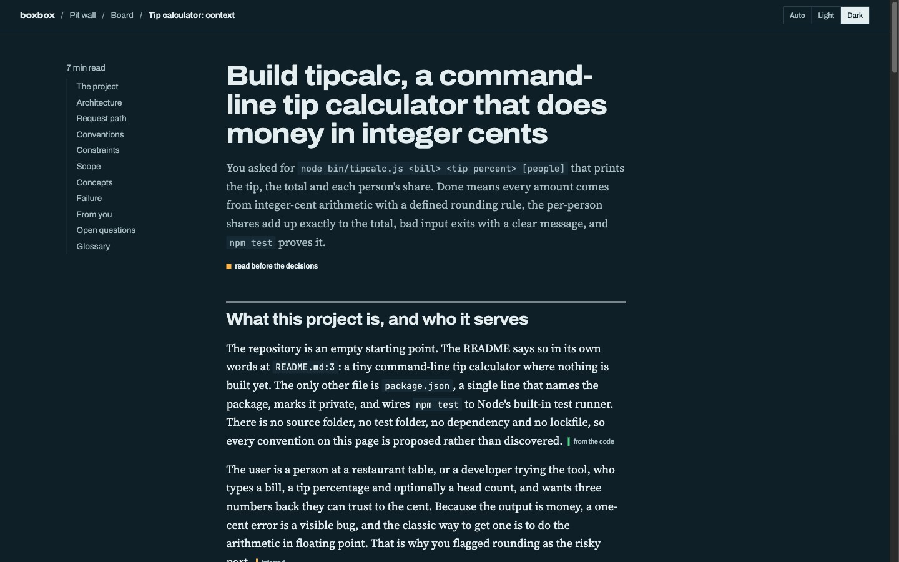

It shows what the project is, the real modules as a diagram, how a request travels today, the patterns to follow, what this feature touches and must not touch, and how it can fail. Skim it once. The "How this can fail" list is the part that pays off: every item becomes a test or a known risk in the plan.

If something is wrong ("we never call the payment service from there"), say so now. Correcting the context costs nothing; correcting a build costs a lot.

### 2. Decisions: answer one at a time

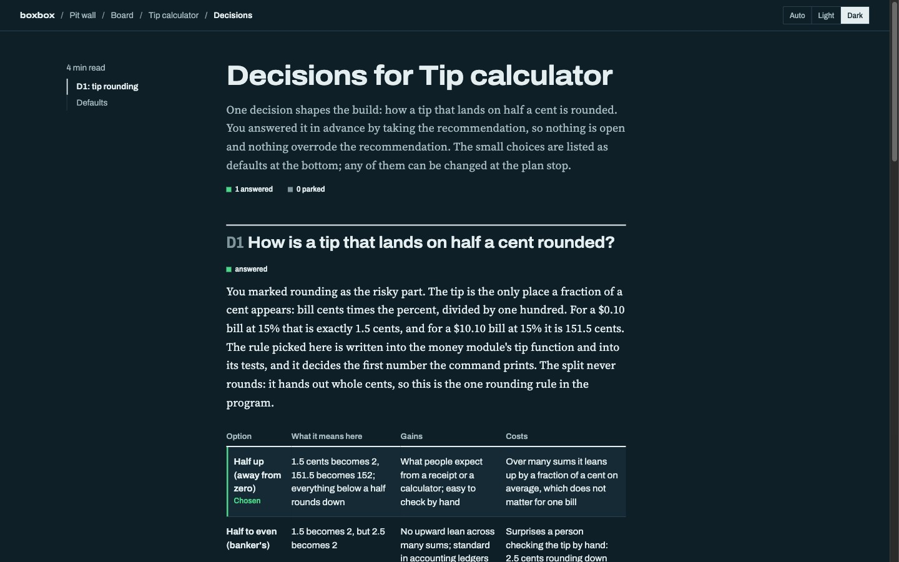

Each card has the question, why it matters now, the options compared, a recommendation tied to your code, and how hard it is to change later. You can:

- **answer**, usually by picking the recommendation;
- say **"explain D2"** or **"why"** to get more before you choose;
- say **"park D3"** to leave it open: the work that depends on it is blocked, the rest goes on;
- override a small default listed at the bottom.

Spend your attention on the cards marked costly or "cannot be undone". Those are the ones only you can make.

### 3. Plan: approve what "done" means

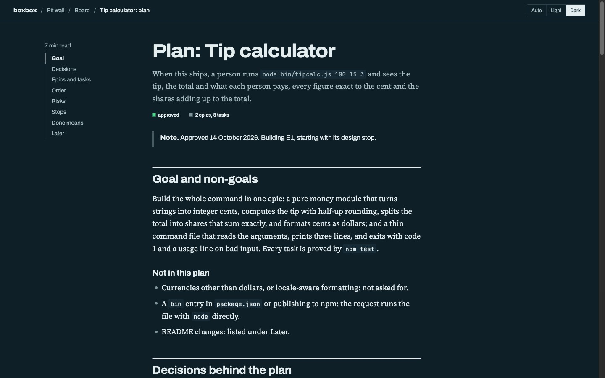

Each epic has an outcome, acceptance criteria ("Done when"), and a list of tasks. Every task has its first test, its size (S, M or L) and a risk tag. Before you say `go`, check three things:

1. Do the acceptance criteria describe what you want? You are approving *done*, not just a task list.
2. Is each epic something you can use or see on its own? An epic like "the model layer" is a smell; ask for vertical slices.
3. Are the risky tasks marked `risk: yes`? Auth, money, migrations and concurrency should be. Risky tasks are built on your strongest model.

At this stop you can also say: `switch to task-level`, `design E2 first`, `use opus for E3`, or `grill the plan` (it will try to break the plan before you commit to it).

### 4. Design (big epics only): approve the shape

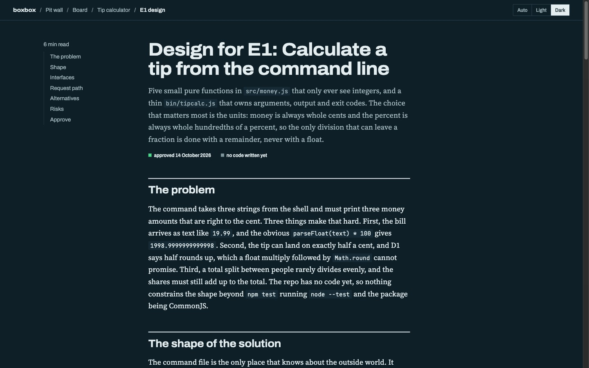

For an epic that adds a module, a data model or a public interface, you see the shapes before any code: types, signatures, the path between them, alternatives considered, and what this locks in. Approving it is cheap; changing a shape after three epics depend on it is not.

### 5. The unit report: review in ten minutes

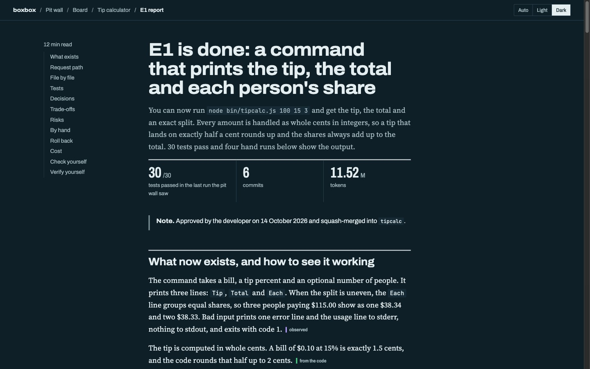

When a unit is done, Boxbox has already run the tests, had a separate agent review the diff, and fact-checked the report. You get the report, the branch, and a draft pull request if pushing is on. A routine that works:

1. **Read the top**: what now exists and how to see it working. Run the "Try it yourself" commands.
2. **Read "Verify these yourself"** at the end: the three claims that matter most if they are wrong, each with a one-minute check. Do at least one.
3. **Skim "File by file"** with the diff open. The page explains the code at your level, so you are reading with a guide, not cold.

   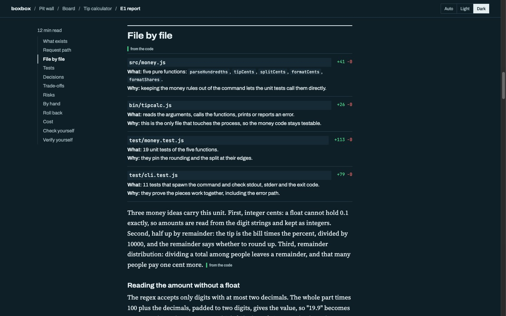

4. **Read "Risks"**: what the reviewer flagged and left, and what was not verified.
5. Say **`approved`**, or **`change ...`**. Changes come back as new commits, never rewritten ones, so you can see exactly what moved.

Each claim on the page says where it comes from: observed, from the code, inferred, unknown, or a linked source. Each test says **verified** (the pit wall saw it pass after the last edit) or **claimed**. Treat "claimed" and "inferred" as prompts to look, not as facts.

## The pit wall: your dashboard

`node .boxbox/pitwall/server.js --ensure` prints the address, usually `http://127.0.0.1:4747/`. It runs only on your machine. Six views:

| | |
| --- | --- |
| 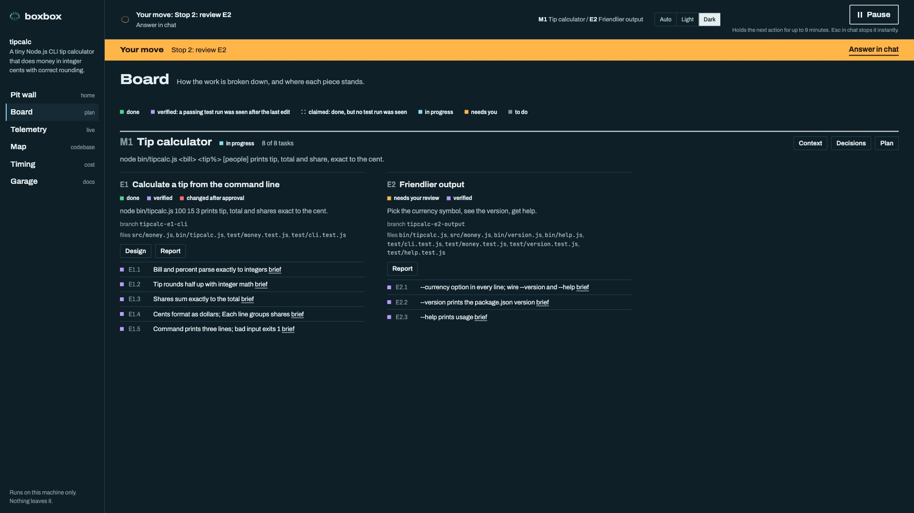 | **Board.** Milestones, epics and tasks, with links to every page and each task's brief. **Verified** means a passing test run was seen after the task's last edit. |
| 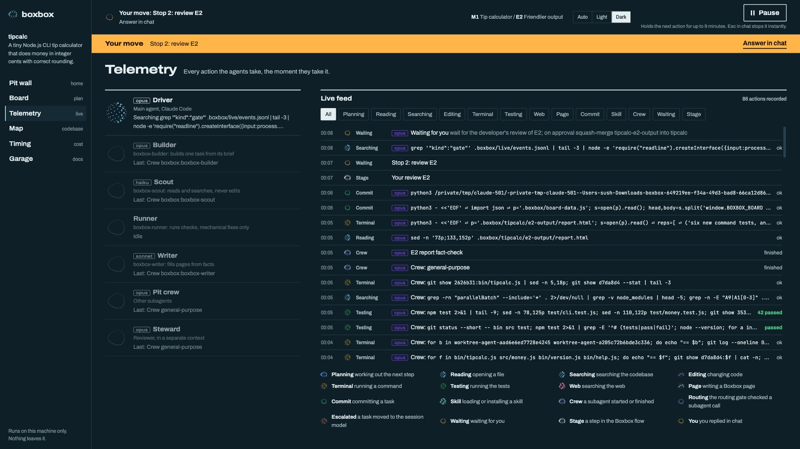 | **Telemetry.** Every action as it happens, with a chip naming the model that did it, and a lane per agent: driver, builder, scout, runner, writer, reviewer. |
| 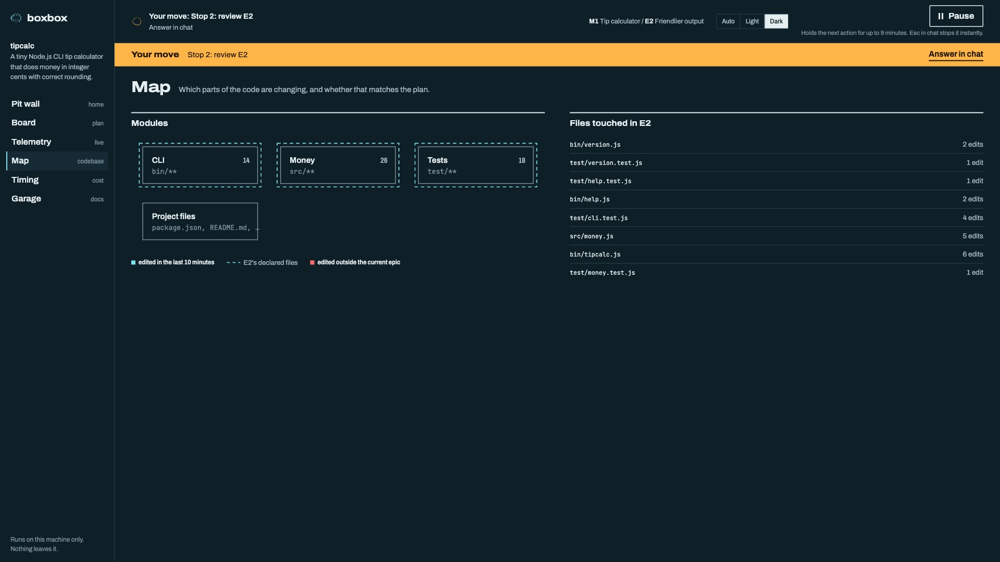 | **Map.** Your modules, which are being edited, and anything edited outside the current epic's files (flagged in red, and listed under "Needs you"). |
| 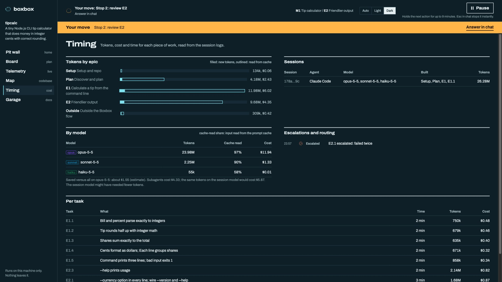 | **Timing.** Tokens and cost per epic, per task and per model, the cache-read share, escalations, and an estimate of what cheaper models saved. |
| 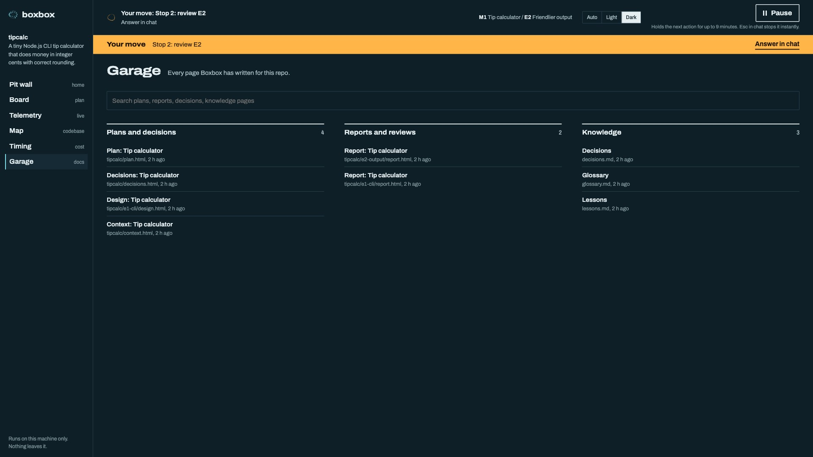 | **Garage.** Every page Boxbox wrote for this repo, searchable. |

**Pause** holds the agent's next action. Resume and nothing is lost; leave it paused for about nine minutes and the agent writes down where it was and waits for `continue`.

## Write requests that work

The agent plans from your words, so a few seconds here saves a re-plan later.

| Instead of | Say |
| --- | --- |
| "add auth" | "let users sign in with email and password; sessions last 7 days; no social login yet" |
| "fix the bug" | "checkout returns 500 when the cart is empty; it should show 'your cart is empty'" |
| "make it faster" | "the orders page takes 4 s with 10k orders; get it under 1 s without changing the API" |
| "refactor payments" | "move payment retries out of the controller into a service, behaviour unchanged" |

Say what is out of scope, name the constraint that matters (a deadline, an API you cannot change, a library you must use), and say which part worries you. "Treat the rounding as risky" gets that task built on the strongest model and tested hardest.

## Spend less without losing quality (Claude Code)

Set `models: balanced` in `.boxbox/config.md`. Planning, decisions, design, task briefs, code review, fact-checks and approvals stay on your session model. Routine work goes to small subagents:

- **`boxbox-builder`** builds one task from its brief, on Sonnet.
- **`boxbox-scout`** pulls code excerpts, on Haiku.
- **`boxbox-runner`** runs checks, on Haiku.
- **`boxbox-writer`** fills pages from facts, on Sonnet.

Tasks tagged risky or size L build on your session model anyway. A routing hook denies any call that breaks these rules and tells the agent the right model. A builder that fails twice is retried once on your session model, and then Boxbox stops and asks you.

What else keeps cost down:

- **Small epics.** A one-sitting review is also a cheap one.
- **Good briefs.** Before each task, the main agent writes a brief with the exact code to touch and the exact tests to write, so the builder does not explore.
- **Read Timing.** If one epic costs much more than the others, look at its tasks. A task that needed three builder runs usually had a vague brief.
- `best` puts everything on your session model; `save` is the cheapest; `auto` leaves model choice to Claude Code.

## Tests: real, and not too many

Every task is built test-first: the first test is written, seen failing, then the code is written. The brief lists exactly which tests to write:

- one logical unit test per behaviour or acceptance criterion;
- one per failure mode;
- one end-to-end test through the real entry point when a user sees the change.

No tests of the language or a library, and no duplicates. The reviewer flags padded tests. If a builder wants another test, it must say why.

Boxbox counts a test run only when it saw it. A report never says "verified" from memory.

## Stay in control

You can say any of these at any stop:

| Say | What happens |
| --- | --- |
| `go`, `approved` | Continue to the next step. |
| `change ...` | Revise the plan or the code, then stop again. |
| `explain ...`, `why ...` | Explain code, or find why it is the way it is (from git and issue history), then return to the stop. |
| `park D3` | Leave a decision open; build what does not depend on it. |
| `design E2 first`, `use opus for E3` | Add a design stop, or pin a model for one epic. |
| `grill the plan` | Challenge the plan with hard questions before you commit. |
| `prototype ...` | Throwaway code to settle a question that only running code can answer. |
| `switch to task-level`, `ask me everything`, `decide and show` | Change how often it stops and how much it asks. |
| `pause`, or the Pause button | Stop cleanly; say `continue` later. |

When you correct how the agent works ("don't add comments to obvious code"), Boxbox records it in `.boxbox/lessons.md` and follows it from then on. If the same mistake happens twice, it proposes a check.

## Working in a team

- **Committed with the code.** `.boxbox/` goes into git with each feature: plan, decisions, reports and the board. A reviewer who was not in the session can read why the code is the way it is.
- **Local only.** `.boxbox/live/` (the pit wall's data) is never committed.
- **Reviewing someone else's branch.** Say "help me review PR 42", or "explain this branch" for work built without Boxbox.
- **Shared settings.** The status line and `parallel: on` write to `.claude/settings.json` only after asking, and setup offers `.claude/settings.local.json` for "just me".

## Agents other than Claude Code

| | Claude Code | Codex | Cursor and others |
| --- | --- | --- | --- |
| Plan, decisions, units, pages | Yes | Yes | Yes |
| Pit wall live feed and pause | Yes | Yes (unverified end to end) | Board only |
| Task briefs | Built by a subagent | Built by the main agent | Built by the main agent |
| Model routing, gate, cost by model, status line, parallel tasks | Yes | No | No |

## Troubleshooting

- **"The kit in .boxbox/ is older than the installed Boxbox plugin."** After an update, ask the agent to refresh the kit (boxbox-setup does it). Until then, pit wall commands may ask for permission.
- **A subagent call was denied by "Boxbox routing".** That is the gate working. The agent should follow the reason it gives (another model, the task id first, or `say escalated`). If it looks wrong, set `models: auto` to step aside and report it.
- **A task shows "claimed", not "verified".** The pit wall did not see a passing test run after that task's last edit, often because files were edited through shell commands it cannot see. Run the test command again.
- **The status line shows nothing.** It needs Node and a `.boxbox/` folder in the directory you started Claude Code in. The VS Code extension may not show status lines; use the pit wall's Home readout.
- **Costs look high.** Open Timing, sort out which epic and model, and check that `models:` is not `best`.
- **You want the old behaviour.** `models: auto` (or no `models:` line) uses no Boxbox subagents at all.

## A good first week

1. **Day 1.** Install, then run one small, real feature end to end with `unit: task`. Read every page fully once.
2. **Day 2 to 3.** Switch to `unit: epic` and `what matters`. Review with the ten-minute routine above.
3. **Then.** Turn on `models: balanced` and watch Timing. Use `grill the plan` on anything costly to reverse, and `explain` on code you inherit.

The goal is not to type less. It is to ship code you can explain, faster than you could write it, without losing the thread.
